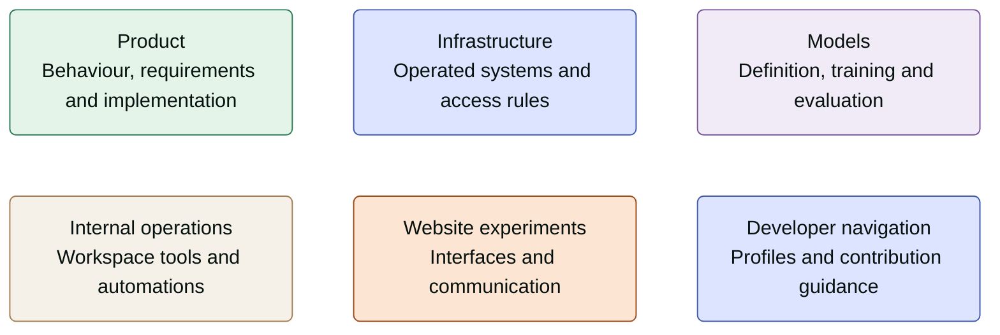

# Welcome to Arbora 🌳

Arbora brings people and responsible AI together to support healthier collaboration.
This GitHub organisation is the home for our shared technical work.

**New developer? Start with the kind of work you are here to do.** The overview below
explains our work areas without publishing the names or contents of private repositories.

## How the work is organised

**Text equivalent:** product work defines what a service does; infrastructure work
covers the systems and access rules used to operate it; model work covers model
construction and evaluation. Internal operations and website experiments have their
own jobs. Developer navigation helps you find the right place to contribute.
These are work areas, not a claim that all code is public or that the areas deploy together.

## Find your starting point

- **Organisation members:** sign in with your approved GitHub account and open the
  organisation's member overview for the complete repository map, reading links and
  access guidance. The repository list depends on your permissions.
- **Public visitors:** browse the public repositories below. For each repository,
  read its README and contribution guidance before proposing a change.
- **Missing access:** ask your Arbora contact or an organisation owner for help.
  Access to private code is granted deliberately, not by making repositories public.

### Public repositories

| Repository | Purpose | Start here |
|---|---|---|
| [terraform-provider-googleworkspace](https://github.com/arbora-partners/terraform-provider-googleworkspace) | Arbora's fork of the Google Workspace Terraform provider. Follow its README for upstream lineage and contribution guidance. | [README](https://github.com/arbora-partners/terraform-provider-googleworkspace/blob/main/README.md) |
| [.github](https://github.com/arbora-partners/.github) | This public organisation welcome. | [Profile source](https://github.com/arbora-partners/.github/blob/main/profile/README.md) |

## Contribute with care

1. Choose the owning repository and read its local instructions.
2. Agree a small goal, confirm the branch and check for overlapping work.
3. Prepare a focused pull request with the applicable checks and review evidence.
4. Keep secrets, private operational details and customer data out of public material.
5. Treat approval to edit, merge and deploy as separate decisions.

Repository-specific rules remain authoritative. This welcome is a wayfinder, not a
release promise, production deployment plan or grant of access.
